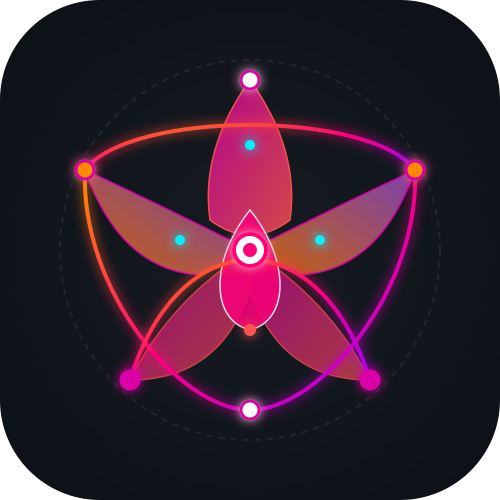

# OpenORCHID

<h3 align="center">
OpenORCHID - Open version of ORCHestration for Inter-Domain management
</h3>
<p align="center">
    
</p>


OpenORCHID is an event-driven orchestration system for managing multi-domain network services (e.g., RAN and CORE). It combines service lifecycle control via the **Saga pattern**, a **dual-bus (NATS + Kafka) integration layer**, and **LLM-based translation** of natural-language intents into structured service requests.

The whole system — domains, their capabilities and behaviour, the intents and the faults that happen along the way — is described by **scenario files (YAML)**. The same scenario runs fully in-process (mocked Kafka, NATS and LLM) or against real infrastructure (each of them can be switched separately), and can carry expectations, which makes it a test.

## Key Ideas

- **Hybrid event architecture** — NATS handles orchestration/control-plane events, while Kafka handles domain/service transport and dynamic channelization.
- **Saga-based lifecycle** — every intent is driven through Preparation → Commissioning → Operation → Decommissioning phases, correlating asynchronous responses across domains.
- **Capability-driven domain selection** — candidate (RAN, CORE) pairs are filtered by coverage and link latency, ranked by a pluggable strategy, and asked for feasibility one by one until one accepts.
- **Dynamic infrastructure** — domain registration and service provisioning automatically create the Kafka topics they need, and lifecycle completion triggers cleanup.
- **Intent-driven ingress** — a FastAPI gateway accepts natural-language intents (translated by an LLM into a strict, validated RFS schema) or structured RFS requests.
- **Built-in observability** — an SLA monitor closes the loop by comparing live telemetry against target constraints and raising compliance/fault signals.

## Quick Start

Requires Python 3.13 and [uv](https://docs.astral.sh/uv/).

```bash
uv sync

# Check a scenario file
uv run python -m idmo_system validate scenarios/multi_domain.yaml

# Run it - by default with in-process mocks of Kafka, NATS and the LLM, no infrastructure needed
uv run python -m idmo_system run scenarios/multi_domain.yaml
```

At the end the runner prints a summary of every intent and checks the scenario's expectations:

```
 #   at_s  intent_id     final state        domains (RAN+CORE)          tries  SLA       last message
 0    0.0  INT-741735FE  HANDLING_ENDED     ran-urban+core-edge             1  -         Service lifecycle expired and resources released.
 1    2.0  INT-651EA11F  REJECTED           -                               4  -         Feasibility check failed for all 4 candidate(s); last: ran-suburban: 1000 MHz requested, 200 MHz available.
 2    4.0  INT-B309317B  HANDLING_ENDED     ran-urban+core-edge             1  degraded  Service lifecycle expired and resources released.
 3    8.0  INT-35E514D4  HANDLING_ENDED     ran-suburban+core-central       4  -         Service lifecycle expired and resources released.
 4   10.0  INT-9441C816  REJECTED           -                               0  -         Orchestration error: No UP RAN/CORE pair matches the request (TA coverage, RAN-CORE links, link latency).
 5   12.0  -             SUBMISSION_FAILED  -                               0  -         HTTP 422: Translation Error: Translator returned no data for the given expression.
Expectations: 6/6 passed
RESULT: PASSED
```

All NATS and Kafka messages, the intent status updates and a `report.json` with the full result (every feasibility attempt, rejection reasons, proposals, status history) are written to `results/<scenario name>/`.

## Example Scenarios

| Scenario | Shows |
|---|---|
| [`basic`](scenarios/basic.yaml) | One RAN, one CORE, one natural-language intent through the whole lifecycle |
| [`multi_domain`](scenarios/multi_domain.yaml) | Domain selection (TA coverage, link latency), capacity limits, retries with the next candidate |
| [`capacity_exhaustion`](scenarios/capacity_exhaustion.yaml) | Least-loaded balancing until capacity runs out; capacity returns when services expire |
| [`domain_failure`](scenarios/domain_failure.yaml) | A crashed RAN and a RAN without heartbeats; resources released for later intents |
| [`sla_degradation`](scenarios/sla_degradation.yaml) | Degrading, randomly fluctuating and temporarily degraded telemetry vs. the SLA |
| [`custom_domain`](scenarios/custom_domain.yaml) | A domain with user-defined logic (custom broker class) |

## Writing a Scenario

```yaml
name: my-scenario
runtime: { duration_s: 60, kafka: mock, nats: mock, llm: mock }   # real / ollama -> docker compose up -d
orchestrator: { domain_selection: lowest_latency, max_candidates: 3 }

domains:
  - name: ran-1
    type: ran
    capabilities: { maxNumberofUEs: 100, nROperatingBands: [n78], coverageAreaTAList: [[260, 1, 100]], positioning: true,
                    core_links: { core-1: 5.0 } }                 # reachable CORE domains and link latency [ms]
    behavior:
      max_bandwidth_mhz: 400                                       # capacity shared by all services on this RAN
      telemetry: { interval_s: 5, profile: constant, throughput_mbps: 80, latency_ms: 10 }
  - name: core-1
    type: core
    capabilities: { cpu: 8, memory_gb: 16, storage_gb: 100, maxNumberofUEs: 5000 }
    behavior: { max_services: 10 }

intents:
  - at_s: 0                                                        # seconds after all domains are up
    rfs: { ran: { bandwidth_mhz: 100, latency_ms: 20, tac: 100, duration_s: 20 }, core: { priority: 1 } }
  - at_s: 5
    expression: We need a RAN with 100MHz bandwidth and 10ms latency. The core network should have 15ms latency and priority 1.

events:
  - { at_s: 10, domain: ran-1, action: degrade, latency_factor: 3.0 }      # 30 ms > the 20 ms requested

expect:
  - { intent: 0, final_state: HANDLING_ENDED, ran: ran-1, sla_degraded: true }
```

The main sections:

- **`runtime`** — run length, `kafka` and `nats` (`mock` / `real`), `llm` (`mock` / `ollama`), endpoints, `seed`, `output_dir`.
- **`orchestrator`** — `domain_selection` strategy, `max_candidates`, `feasibility_timeout_s`.
- **`registry`** — `heartbeat_interval_s`, `max_missed_heartbeats`.
- **`domains`** — `capabilities` (what the domain registers with) and `behavior` (capacity, telemetry profile).
- **`intents`** — natural-language `expression` (translated by the LLM) or structured `rfs`.
- **`translations`** — answers of the mock LLM: expression → RFS.
- **`events`** — `crash`, `stop_heartbeat`, `degrade` / `restore` at a given time.
- **`expect`** — per intent: `final_state`, `ran`, `core`, `attempts`, `sla_degraded`, `message_contains`.

The files are validated strictly (unknown fields, references to unknown domains and similar mistakes are reported with their location), and `python -m idmo_system run` exits with code 1 when an expectation fails.

### How domains are chosen

1. **Filtering** (orchestrator, from registered capabilities): the domain is UP, the RAN covers the requested
   TA (`rfs.ran.tac`), the RAN has a link to the CORE (`core_links`) and the link latency is within `rfs.core.latency_ms`.
2. **Ranking** with the strategy set in `orchestrator.domain_selection`: `first_available`, `least_loaded`,
   `lowest_latency` or `random`.
3. **Feasibility with retries**: the saga asks the best (RAN, CORE) pair; each domain checks its *current* load
   (RAN: bandwidth, UEs, coverage; CORE: number of services, UEs) and holds the resources when it accepts.
   If either domain rejects, the holds are released and the next pair is tried, up to `orchestrator.max_candidates`.
   A rejected intent reports the reasons and what the domains could offer instead.

## Extending

**Own domain logic** — subclass `RANDomainBroker` or `CoreDomainBroker` and point the scenario at it; `params` are passed to the constructor:

```yaml
  - name: ran-hospital
    type: ran
    class: examples.priority_ran:PriorityRanBroker
    params: { protected_mhz: 50 }
```

See [`examples/priority_ran.py`](examples/priority_ran.py): a RAN that keeps part of its bandwidth for priority-1 services. The methods to override are `handle_feasibility()`, `resources_for()`, `handle_provisioning()`, `compute_metrics()` (RAN telemetry) and `apply_event()`.

**Own selection strategy** — register a function that orders the candidates, before the scenario is loaded:

```python
from idmo_system.core.domain_selection import register_strategy

@register_strategy("prefer_central")
def prefer_central(candidates, rng):
    return sorted(candidates, key=lambda c: c.core != "core-central")
```

**From Python** — scenarios can be built in code or loaded from YAML and run programmatically:

```python
import asyncio

from idmo_system.scenario import Scenario
from idmo_system.runner import ScenarioRunner

result = asyncio.run(ScenarioRunner(Scenario.from_yaml("scenarios/basic.yaml")).run())
print(result.summary())
print(result.to_dict()["intents"][0]["attempts"])
```

## Running on Real Infrastructure

`docker-compose.yaml` starts Kafka (`broker`, with Kafka UI on port 8080), NATS and Ollama with the `qwen2.5-coder:1.5b` model.
Kafka, NATS and the LLM are switched independently — in the scenario (`runtime.kafka`, `runtime.nats`, `runtime.llm`)
or on the command line. For example, real Kafka and NATS with the in-process (mock) LLM:

```bash
docker compose up -d broker nats
uv run python -m idmo_system run scenarios/multi_domain.yaml --kafka real --nats real
```

With real Kafka the runner deletes all `unity6g.*` topics before each run, and every domain needs a few seconds until
it is UP (the adapter discovers new topics through a metadata refresh every 5 s). The services are reached via
`127.0.0.1` (not `localhost`, which on some systems resolves to IPv6 first and makes every Kafka connection wait ~20 s).

The intent gateway (`GET /intents`, `GET /intents/{intent_id}`, `POST /intents`) listens on `runtime.gateway_port` (8000) while a scenario runs.

## Tests

```bash
uv run pytest                     # unit tests + every scenario in scenarios/ (~3 min)
uv run pytest -m "not scenario"   # unit tests only (~1 s)

# every scenario against the docker-compose services (skipped unless OPENORCHID_REAL is set)
docker compose up -d broker nats
OPENORCHID_REAL=kafka,nats uv run pytest -m real_infra
```

Every file in `scenarios/` must have an `expect` section — adding a scenario adds a test.

## Known Limitations

This is a demonstrator, not a production orchestrator:

- **No recovery.** When a domain is lost or the SLA stays violated, the intent ends (the surviving domain releases its
  resources) — the service is not re-provisioned on another candidate.
- **No persistence.** The domain registry, the sagas and the intent state repository live in memory; restarting a
  component loses its state.
- **A lost domain cannot come back** under the same name during a run (re-registration after a heartbeat loss is not handled).
- **One process.** All components and simulated domains run in a single process; there is no distributed deployment yet.
- **Simulated domains.** RAN and CORE brokers model capacity and telemetry, they do not control real network functions.
- **Simplified selection.** Frequency bands, positioning and compute capabilities (CPU, memory) are registered but not
  used in domain selection.
- **Tested setups:** every scenario in mock mode and with real Kafka and NATS (separately and together).
  The Ollama LLM has not been re-verified since the scenario-based refactoring.

## Architecture at a Glance

| Layer | Responsibility |
|---|---|
| `idmo_system/core/` | Service orchestration (Saga), domain selection, domain registry, SLA monitoring |
| `idmo_system/communication/` | NATS↔Kafka bridge and shared message contracts (capabilities, RFS) |
| `idmo_system/domains/` | Domain broker base + RAN/CORE brokers, behaviour and events |
| `idmo_system/gateway/` | HTTP intent ingress and NL→RFS translation |
| `idmo_system/scenario.py`, `runner.py`, `__main__.py` | Scenario model, runner and CLI |
| `idmo_system/mocks/` | In-process mocks for Kafka, NATS and the LLM |
| `scenarios/`, `examples/`, `tests/` | Example scenarios, a custom domain broker, the test suite |
